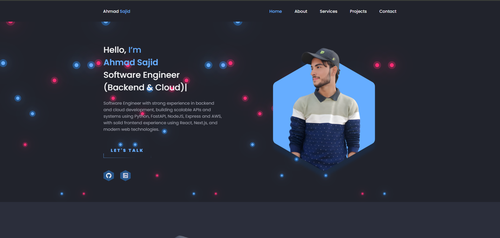

# Personal Portfolio Website



This is a clean, modern, and responsive personal portfolio website built with HTML, CSS, and vanilla JavaScript. It's designed to showcase projects, skills, and professional experience in an elegant and effective way.

[](https://ahmad-sajid-s-portfolio.vercel.app/)

## Features

-   **Fully Responsive Design:** Optimized for a seamless experience on all devices, including desktops, tablets, and smartphones.
-   **Dark Mode:** A beautiful dark mode theme for a comfortable viewing experience in low-light environments.
-   **Dynamic Scroll Animations:** Uses the [ScrollReveal.js](https://scrollrevealjs.org/) library to add smooth, engaging animations as you scroll through the sections.
-   **Active Link Highlighting:** The navigation menu automatically highlights the section currently in view.
-   **Structured Sections:** Includes all essential portfolio sections:
    -   Home
    -   About
    -   Skills
    -   Projects
    -   Contact
-   **Project Showcase:** A dedicated section to display your projects with images, descriptions, and links.
-   **Skills Section:** A visually appealing section to highlight your skills and expertise.
-   **Downloadable Resume:** A direct link to download the curriculum vitae in PDF format.
-   **Clean & Organized Code:** The codebase is well-structured, making it easy to understand, maintain, and customize.

## Technologies Used

-   **HTML5:** For the semantic structure of the website.
-   **CSS3:** For modern styling, layout (including Flexbox and CSS Grid), and responsive design.
-   **Vanilla JavaScript (ES6+):** For interactivity, DOM manipulation, and implementing the scroll-based features.
-   **Remixicon:** A set of open-source icons.
-   **ScrollReveal.js:** A third-party library to reveal elements on scroll.
viewport.
-   **Formspree:** A service to send emails using client-side technologies only.
-   **Typed.js:** A library for creating typing animations.

## 📂 Project Structure

The project follows a standard static website structure:

```
├───index.html
├───LICENSE
├───README.md
└───assets/
    ├───css/
    │   └───styles.css
    ├───img/
    │   ├───... (images and assets)
    └───js/
        ├───main.js
        ├───scrollActive.js
        └───scrollreveal.min.js
```

## Getting Started

To get a local copy up and running, follow these simple steps.

### Prerequisites

You will need a modern web browser to open the `index.html` file.

### Installation

1.  **Clone the repository:**
    ```sh
    git clone https://github.com/ahmad-sajid-32/Ahmad-Sajid-s-Personal-Portfolio.git
    ```
2.  **Navigate to the project directory:**
    ```sh
    cd Ahmad-Sajid-s-Personal-Portfolio
    ```
3.  **Open the website:**
    Simply open the `index.html` file in your web browser. No build process or dependencies are required.


## 🤝 Contributing

Contributions are welcome! If you have any suggestions or find any bugs, please open an issue or submit a pull request.

1.  Fork the Project
2.  Create your Feature Branch (`git checkout -b feature/AmazingFeature`)
3.  Commit your Changes (`git commit -m 'Add some AmazingFeature'`)
4.  Push to the Branch (`git push origin feature/AmazingFeature`)
5.  Open a Pull Request


## License

This project is licensed under the **MIT License**. See the [LICENSE](./LICENSE) file for more details.

## 🙏 Acknowledgements

-   [Remixicon](https://remixicon.com/)
-   [ScrollReveal](https://scrollrevealjs.org/)
-   [Formspree](https://formspree.io/)
-   [Typed.js](https://github.com/mattboldt/typed.js/)

## 📧 Contact

-   **GitHub:** [@ahmad-sajid-32](https.github.com/ahmad-sajid-32)
-   **LinkedIn:** [Ahmad Sajid](https://www.linkedin.com/in/ahmad-sajid-offcial/)

---

Crafted with ❤️ by Ahmad Sajid
